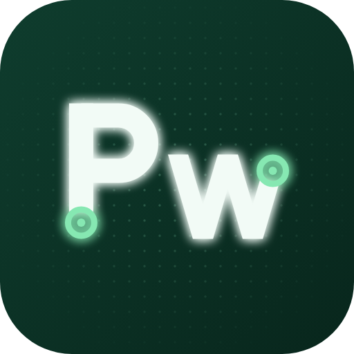
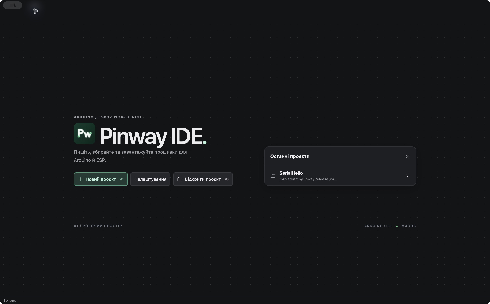

# Pinway IDE

[](https://github.com/Zen7q/Pinway-IDE/actions/workflows/build.yml)
[](https://github.com/Zen7q/Pinway-IDE/releases)
[](LICENSE)
[](https://github.com/Zen7q/Pinway-IDE/releases)

A desktop IDE for Arduino C++ and ESP32, with a familiar editor layout and a macOS-inspired interface. Write firmware in Code, then add the Build circuit editor and Display interface designer when you need them.

**[Download Pinway IDE](https://github.com/Zen7q/Pinway-IDE/releases/tag/v0.3.2)** · [User guide](docs/USAGE.md) · [Report a bug](https://github.com/Zen7q/Pinway-IDE/issues)

**0.3.2 alpha** is an early preview published as a regular release. Its numeric update version is `0.3.2`, so the updater in 0.3.1 can find it. It fixes workspace selection after a cold start and hides background Arduino CLI consoles on Windows.

## Install

- **macOS, Apple Silicon** — open the release `.dmg` and drag Pinway IDE into Applications. Requires macOS 13+ and Rosetta 2 for the AVR compiler and Arduino ctags.
- **Windows x64** — run the release `.exe` installer. Requires a Windows version supported by WebView2. The installer is built on Windows through GitHub Actions.
- **Linux / Docker** — use the firmware compilation container below. Desktop Linux packaging is available from source.

The base installation includes **Pinway Code + Arduino AVR** for boards such as Uno, Nano and Mega. On first launch, choose your theme, board support and optional workspaces. ESP32 support, Build and Display are downloaded separately. You can add or remove packages later in Settings.

The macOS build uses an ad-hoc signature and has not been notarized by Apple. The Windows build still needs USB testing on physical hardware. The CI badge above shows the current automated build and test status. The current application interface is in Ukrainian.

## Quick start

1. Create a project, such as `SerialHello`, and choose a folder.
2. Paste the sketch below, select your board and click **Verify** (`Перевірити`).
3. Connect your board, check the selected port and click **Upload** (`Завантажити`).
4. Open **Serial Monitor** at 115200 baud.

```cpp
void setup() {
  Serial.begin(115200);
}

void loop() {
  Serial.println("Hello from Pinway!");
  delay(1000);
}
```

For a Nano with the old bootloader, select **Tools → Processor → ATmega328P (Old Bootloader)**. Install the ESP32 board package before working with ESP boards. If USB detection identifies only the chip or serial adapter, select the exact board profile manually.

## Features

- C++ editor with syntax highlighting, Arduino completions and compiler diagnostics linked to source lines.
- Standard `.ino` projects, file navigation, recent projects and draft recovery.
- Arduino CLI compilation and upload, with board and port settings in Tools.
- Library Manager, Serial Monitor and Plotter.
- **Build** — breadboards, schematics and PCB planning. Current PCB footprints are illustrative. Fabrication export is still pending.
- **Display** — device interface layouts, local previews and firmware generation for supported displays. See the [display catalog](docs/display-catalog.md) for supported profiles and implementation limits.
- Optional packages and user-controlled application updates.
- Light, dark and system themes, a green default accent and interface scaling.

Updates are optional. **Update IDE** downloads and verifies the platform installer, then opens it so you can complete installation when ready. Automatic checks can be disabled in Settings.

## Preview




## Why Pinway?

Pinway brings firmware, circuits and device screens into one project. The base installation provides an Arduino starting point, while optional tools let each user choose what to install.

| Environment | Workflow |
|---|---|
| Pinway IDE | A standalone application with Code and optional Build/Display workspaces in one project. |
| Arduino IDE | The official Arduino sketch environment, with board and library management and Serial Monitor. |
| PlatformIO IDE | A VS Code extension for embedded development using PlatformIO project configuration. |

For details on the alternatives, see the official [Arduino IDE documentation](https://docs.arduino.cc/software/ide-v2/) and [PlatformIO IDE documentation](https://docs.platformio.org/en/latest/integration/ide/vscode.html).

## Build from source

Requires Node.js 24, Python 3.12+, Rust stable and the platform dependencies for Tauri. On macOS, install Xcode Command Line Tools as well.

```sh
npm ci
npm run dev
```

To create a DMG or Windows EXE, run `npm run package:tauri` on the corresponding operating system. The installer is written to a new `dist/release-<timestamp>` directory. The first run downloads the base Arduino tools. See [packaging, packages and updates](docs/RELEASE.md).

## Docker

```sh
docker build -t pinway-cli .
docker run --rm pinway-cli version
```

A prebuilt Linux x86_64 `pinway-cli-docker.tar.gz` is also provided in Releases. Load it with `docker load -i pinway-cli-docker.tar.gz`.

To compile `Blink/Blink.ino` inside your current directory, run the following command.

```sh
docker run --rm -v "$PWD:/workspace" pinway-cli compile --fqbn arduino:avr:uno /workspace/Blink
```

Include ESP32 support with `docker build --build-arg ESP32=true -t pinway-cli-esp .`. The image provides Arduino CLI for firmware builds. Install the desktop interface using the DMG or EXE.

## Contributing

Use [Issues](https://github.com/Zen7q/Pinway-IDE/issues) for bugs and proposals, and pull requests for changes. Read [CONTRIBUTING.md](CONTRIBUTING.md) and our [Code of Conduct](CODE_OF_CONDUCT.md) before contributing.

## License

The [Pinway IDE Source-Available License 1.0](LICENSE) permits source inspection, modification, free redistribution and commercial firmware development. Selling the IDE or derivative versions requires written permission. Third-party components retain their own licenses. See [third-party notices](THIRD_PARTY.md) for bundled components.
