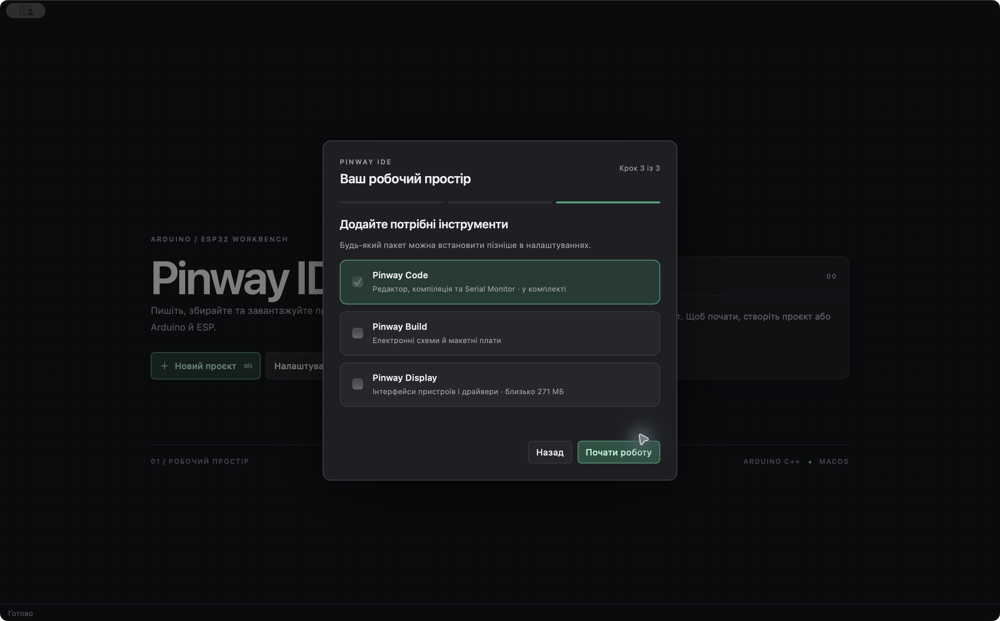

# Pinway IDE

[](https://github.com/Zen7q/Pinway-IDE/actions/workflows/build.yml)
[](https://github.com/Zen7q/Pinway-IDE/releases)
[](LICENSE)
[](https://github.com/Zen7q/Pinway-IDE/releases)

Десктопна IDE для Arduino C++ та ESP32 зі знайомим компонуванням редактора й оформленням у стилі macOS. Пишіть прошивки в Code, додавайте редактор схем Build та інтерфейсів пристроїв Display, коли вони потрібні.

**[Завантажити інсталятор](https://github.com/Zen7q/Pinway-IDE/releases/latest)** · [Посібник](docs/USAGE.md) · [Повідомити про помилку](https://github.com/Zen7q/Pinway-IDE/issues)

## Встановлення

- **macOS Apple Silicon** — відкрийте `.dmg` із релізу й перетягніть Pinway IDE в Applications. Потрібна macOS 13+ та Rosetta 2 для AVR-компілятора й Arduino ctags.
- **Windows x64** — запустіть `.exe` із релізу. Потрібна Windows із підтримкою WebView2. Інсталятор збирається окремо на Windows у GitHub Actions.
- **Linux / Docker** — контейнер для компіляції скетчів описаний нижче. Пакування десктопної Linux-версії доступне з вихідного коду.

Базове встановлення містить **Pinway Code + Arduino AVR** для Uno, Nano й Mega. На першому запуску виберіть тему, потрібні плати та інструменти. Пакет ESP32, Build і Display встановлюються додатково через інтернет. Встановленими пакетами можна керувати в налаштуваннях.

macOS-збірка має ad-hoc підпис і поки проходить без Apple notarization. Windows-збірка потребує перевірки USB на реальному обладнанні. Стан автоматичних перевірок показує CI вище.

## Швидкий старт

1. Створіть проєкт, наприклад `SerialHello`, і виберіть папку.
2. Вставте код нижче, виберіть свою плату й натисніть **Перевірити**.
3. Підключіть плату, перевірте порт і натисніть **Завантажити**.
4. Відкрийте **Serial Monitor** на 115200 бод.

```cpp
void setup() {
  Serial.begin(115200);
}

void loop() {
  Serial.println("Hello from Pinway!");
  delay(1000);
}
```

Для Nano зі старим бутлоадером виберіть **Tools → Processor → ATmega328P (Old Bootloader)**. Для ESP32 спочатку встановіть пакет плат. Якщо USB визначає тільки чип або послідовний адаптер, точний профіль плати можна вибрати вручну.

## Можливості

- Редактор C++ із підсвічуванням, Arduino-автодоповненням і переходом від помилки збірки до рядка коду.
- Відкриття звичайних `.ino`-проєктів, дерево файлів, останні проєкти й відновлення чернеток.
- Arduino CLI для компіляції та прошивання, параметри плати й порту в Tools.
- Менеджер бібліотек, Serial Monitor і Plotter.
- **Build** — макетні плати, електричні схеми й планування PCB. Поточні PCB footprints ілюстративні, fabrication export ще потребує реалізації.
- **Display** — макети інтерфейсів, локальне превʼю та генерація прошивок для підтримуваних дисплеїв. Перелік і межі підтримки наведено в [каталозі](DISPLAY-CATALOG.md).
- Додаткові пакети за потреби та добровільне оновлення IDE через налаштування.
- Темна, світла й системна теми, зелений акцент за замовчуванням, масштабування інтерфейсу.

## Як це виглядає



## Навіщо Pinway

Pinway розвивається як єдиний робочий простір для прошивки, схеми та екрану пристрою. Його базове встановлення орієнтоване на швидкий старт з Arduino, а додаткові інструменти користувач вибирає сам.

| Варіант | Робочий сценарій |
|---|---|
| Pinway IDE | Окремий застосунок із Code та додатковими Build/Display у спільному проєкті. |
| Arduino IDE | Офіційне Arduino-середовище для скетчів із менеджерами плат і бібліотек та Serial Monitor. |
| PlatformIO IDE | Розширення VS Code для embedded-розробки з конфігурацією проєктів PlatformIO. |

Деталі альтернатив наведено в офіційній документації [Arduino IDE](https://docs.arduino.cc/software/ide-v2/) та [PlatformIO IDE](https://docs.platformio.org/en/latest/integration/ide/vscode.html).

## Збірка з коду

Потрібні Node.js 24, Python 3.12+, Rust stable і системні залежності Tauri. На macOS також потрібні Xcode Command Line Tools.

```sh
npm ci
npm run dev
```

Для DMG або Windows EXE виконайте `npm run package:tauri` на відповідній системі. Інсталятор потрапить у нову папку `dist/release-<дата-час>`. Перший запуск команди завантажує базові Arduino-інструменти. [Пакування, пакети й оновлення](docs/RELEASE.md)

## Docker

```sh
docker build -t pinway-cli .
docker run --rm pinway-cli version
```

Щоб скомпілювати скетч `Blink/Blink.ino` у поточній папці, виконайте команду нижче.

```sh
docker run --rm -v "$PWD:/workspace" pinway-cli compile --fqbn arduino:avr:uno /workspace/Blink
```

Пакет ESP32 можна включити через `docker build --build-arg ESP32=true -t pinway-cli-esp .`. Образ надає Arduino CLI для збірки прошивок. Десктопний інтерфейс встановлюється через DMG або EXE.

## Внесок

Помилки й пропозиції приймаються через [Issues](https://github.com/Zen7q/Pinway-IDE/issues), зміни — через pull requests. Порядок роботи описаний у [CONTRIBUTING.md](CONTRIBUTING.md), правила спільноти — у [CODE_OF_CONDUCT.md](CODE_OF_CONDUCT.md).

## Ліцензія

[Pinway IDE Source-Available License 1.0](LICENSE) дозволяє перегляд коду, зміни, безкоштовне поширення й використання для комерційної розробки прошивок. Продаж IDE та похідних версій потребує письмового дозволу. Сторонні компоненти зберігають власні ліцензії. [Результати перевірки й відкриті юридичні питання](LICENSE-REVIEW.md)
